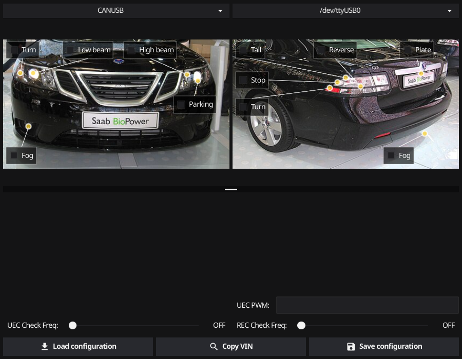

# Saab NG9-3 Halogen Check Disabler


A Windows tool for the Saab 9-3 (2003+, "NG9-3") that turns the bulb outage
monitoring on or off per light. The car periodically pulses current through the
bulbs to verify they are intact; aftermarket LED bulbs draw so little current
that this check flags them as burned out, giving false "bulb failure" messages
on the SID and hyper-flashing turn signals. This tool lets you disable the
check for exactly the lights you have converted, instead of turning the
monitoring off wholesale.

No firmware is modified — the tool reads and writes the configuration values
the factory tools use, over the diagnostic protocol.



Each checkbox is drawn on a photo of the car, pointing at the light it
controls — front lights on the left photo (UEC), rear lights on the right
(REC).

## How it works

The NG9-3 body electronics sit on GMLAN single-wire CAN (SWCAN, 33.3 kbit/s,
pin 1 of the OBD-II connector). Bulb monitoring is handled by two modules:

- **UEC** (Under-hood Electrical Center) — front lights. Diagnostic address
  `0x24F`, responds on `0x64F`.
- **REC** (Rear Electrical Center) — rear lights. Diagnostic address `0x249`,
  responds on `0x649`.

The tool talks GMLAN diagnostics to both modules using
[gocan](https://github.com/roffe/gocan):

| Module | Identifier | Contents |
|--------|-----------|----------|
| UEC | `0x90` | VIN |
| UEC | `0x40` | PWM output configuration |
| UEC | `0x4D` | Bulb check configuration, front |
| REC | `0x45` | Bulb check configuration, rear |

Byte 0 of each configuration is the check interval in ticks of 14.5 ms
(0 = checking off). Byte 1 (and byte 2 for rear turn signals) is a bit mask
with one bit per light:

| UEC byte 1 | Light | | REC byte 1 | Light |
|-----------|-------|-|-----------|-------|
| `0x80` | Front parking lights | | `0x80` | Tail lights |
| `0x40` | Front fog lights | | `0x40` | Rear fog lights |
| `0x20` | Low beams | | `0x20` | Stop lights |
| `0x10` | High beams | | `0x10` | Reverse light |
| `0x01` | Front turn signals | | `0x08` | License plate |
| | | | byte 2 `0x08` | Rear turn signals |

A checked box in the UI means the check is enabled for that light; uncheck the
lights you have converted to LED and save.

## Usage

1. Connect your adapter to the car and turn the ignition on.
2. Select your adapter (and COM port if it needs one) in the dropdowns.
3. Press **Load configuration** — the current settings are read from the car
   and shown as checkboxes on the car photos.
4. Uncheck the lights you want excluded from bulb monitoring.
5. Press **Save configuration** to write the settings back.

You must load the configuration from the car before you can save — the tool
only writes back values it has read, with your changes applied.

**Before changing anything**, press `Ctrl+Tab` to show the raw UEC/REC hex
values and write them down. They are your factory configuration and your way
back if you want to restore it later.

### Supported adapters

Any gocan-supported adapter that can do single-wire CAN, including the GM
Tech2 used as a J2534 passthru device. The installer optionally bundles the
Tech2 SAE J2534 driver; when the Tech2 adapter is selected, a port selector
appears that configures the driver's COM port for you (this writes to the
registry, which is why the tool asks for administrator rights).

### Keyboard shortcuts

- `Ctrl+Tab` — show/hide the raw UEC/REC configuration hex values
- `Ctrl+O` — show/hide a manual port name entry, for ports the dropdown
  doesn't list

## Installation

Grab either from the [latest release](../../releases/latest):

- `hcd_setup.zip` — installer, optionally including the Tech2 J2534 driver
  and a software OpenGL renderer for machines without working GPU drivers.
- `hcd.zip` — just the portable exe.

## Building from source

Requirements: Go, the fyne CLI matching the fyne version in go.mod
(`go install fyne.io/fyne/v2/cmd/fyne@v2.3.5`),
`go install github.com/akavel/rsrc@latest`, a mingw-w64 i686 C compiler and
NSIS (for the installer). On Linux: `apt install gcc-mingw-w64-i686 nsis`.

```sh
make        # builds "Saab NG9-3 Halogen Check Disabler.exe"
make setup  # also builds the NSIS installer hcd_setup.exe
```

The exe is built for 32-bit Windows (`GOARCH=386`) so it can load 32-bit
J2534 DLLs such as the Tech2's `Tech2_32.dll` in-process.

## Photo credits

The car photos in the UI are public domain, from Wikimedia Commons:
[front view](https://commons.wikimedia.org/wiki/File:Saab_9-3-Sedan_MY-08_Front-view2.jpg)
and [rear view](https://commons.wikimedia.org/wiki/File:Saab_9-3-Sedan_MY-08_Rear-view.JPG)
of a MY08 9-3 sedan.

## Disclaimer

This tool writes configuration to your car's body electronics. It is provided
as-is, without warranty of any kind — use at your own risk. Save your original
configuration values before changing anything, and check your local vehicle
inspection rules before disabling bulb monitoring.
